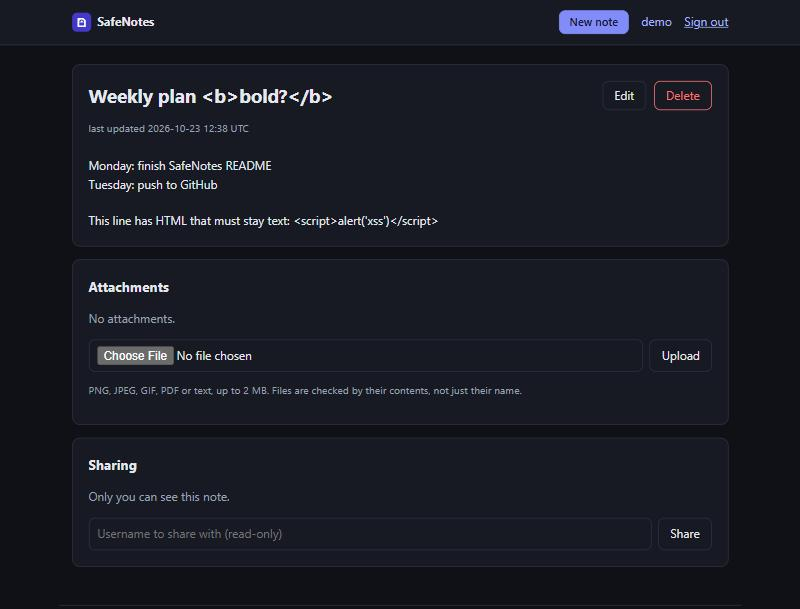

# SafeNotes: a secure-by-design web app

A small notes app (accounts, private notes, read-only sharing, file attachments) built to show **how to defend a web application against the OWASP Top 10**. Every defence has automated tests that prove it works, and CI also runs static analysis and a dependency audit on every push.



It's built with Python, Flask and SQLite, with no JavaScript at all, so the Content-Security-Policy can block scripts completely.

## Run it

```bash
cd projects/secure-webapp
python -m venv .venv
.venv\Scripts\activate          # Linux/macOS: source .venv/bin/activate
pip install -r requirements.txt
flask --app safenotes run
```

Open <http://127.0.0.1:5000> and create an account. Data is stored in `instance/`, which git ignores.

For production, set `SAFENOTES_ENV=production` and a random `SAFENOTES_SECRET_KEY` (at least 32 characters; the app refuses to start without one), and run it behind HTTPS. A `Dockerfile` (gunicorn, non-root user) is included.

## How each OWASP Top 10 (2021) risk is handled

| Risk | What SafeNotes does | Where | Proved by |
|---|---|---|---|
| **A01 Broken access control** | Every note, edit, share and attachment goes through one `load_note()` check. Notes you can't see return **404** (same as non-existent, so ids can't be probed). Read-only shares return 403 on writes. Attachments inherit the note's permissions. Login redirects only go to local paths (no open redirect). | [`notes.py`](safenotes/notes.py), [`security.py`](safenotes/security.py) `safe_next` | [`test_access_control.py`](tests/test_access_control.py) |
| **A02 Cryptographic failures** | Passwords hashed with **scrypt** (memory-hard, unique salt). Session tokens are 256-bit random values, and only their SHA-256 is stored. In production: `Secure` + `__Host-` cookie, HSTS. | [`passwords.py`](safenotes/passwords.py), [`config.py`](safenotes/config.py) | [`test_auth.py`](tests/test_auth.py), [`test_config_and_headers.py`](tests/test_config_and_headers.py) |
| **A03 Injection** | Every SQL query uses `?` placeholders, with no string-built SQL anywhere. `LIKE` wildcards in search are escaped. Jinja auto-escaping for all output, and notes are shown as text, not HTML. | [`db.py`](safenotes/db.py), [`notes.py`](safenotes/notes.py), templates | [`test_injection.py`](tests/test_injection.py) |
| **A04 Insecure design** | Uploads: allowlist of types, type decided from the **file's bytes** and must match the extension, random stored names with no extension, kept outside the web root, size and count limits, and always served as a download with `nosniff` and a sandbox CSP. | [`uploads.py`](safenotes/uploads.py) | [`test_uploads.py`](tests/test_uploads.py) |
| **A05 Security misconfiguration** | Strict CSP (`default-src 'none'`, no scripts), `X-Frame-Options`, `nosniff`, `Referrer-Policy`, COOP/CORP, `Cache-Control: no-store` on private pages, generic error pages (no stack traces), and production won't start without a strong secret. | [`security.py`](safenotes/security.py), [`__init__.py`](safenotes/__init__.py) | [`test_config_and_headers.py`](tests/test_config_and_headers.py) |
| **A06 Vulnerable components** | Pinned dependencies, with **pip-audit** in CI checking them against known CVEs. | [`requirements.txt`](requirements.txt), [CI](../../.github/workflows/ci.yml) | CI |
| **A07 Authentication failures** | Password policy per NIST 800-63B (12+ chars, common-password list, no username). Login throttling per username **and** per IP. Same error and same timing for unknown users (dummy hash). New session on login (no fixation). **Server-side sessions** that logout really revokes, with 30-min idle and 12-h absolute timeouts. A password change signs out other devices, and there's an active-sessions page. | [`auth.py`](safenotes/auth.py), [`security.py`](safenotes/security.py), [`passwords.py`](safenotes/passwords.py) | [`test_auth.py`](tests/test_auth.py) |
| **A08 Integrity failures** (incl. CSRF) | Every state-changing request needs the session's CSRF token (constant-time compare) **and** a same-origin `Origin` header. `SameSite=Lax` cookies. GET never changes state. | [`security.py`](safenotes/security.py) `check_csrf` | [`test_csrf.py`](tests/test_csrf.py) |
| **A09 Logging & monitoring failures** | JSON-lines **audit log** of security events: logins (success, failure, throttled), registration, password changes, denied access, rejected CSRF and uploads, sharing, account deletion. JSON encoding means attackers can't forge log lines with newlines. | [`security.py`](safenotes/security.py) `audit` | [`test_config_and_headers.py`](tests/test_config_and_headers.py) and others |
| **A10 SSRF** | The app never fetches URLs supplied by users. (For an SSRF guard in practice, see the [OSINT dashboard](../OSINT-dashboard).) | n/a | n/a |

## Tests and CI

```bash
pip install -r requirements-dev.txt
pytest                      # 79 security-focused tests
bandit -r safenotes         # static analysis: no issues, no suppressions
pip-audit -r requirements.txt
```

The tests act like an attacker would through the browser, but against the app's own test client: they replay a cookie after logout, swap note ids between users, upload an executable renamed to `.png`, submit forms without a CSRF token or from another origin, and inject newlines into the audit log. Each test checks that the defence holds.

The repo's [GitHub Actions workflow](../../.github/workflows/ci.yml) runs these checks, plus the tests of the other two portfolio projects, on every push.

## Example audit log

```json
{"ts": "2026-10-23T12:40:02+00:00", "event": "login_failure", "ip": "203.0.113.7", "user": null, "username": "alice"}
{"ts": "2026-10-23T12:40:09+00:00", "event": "login_throttled", "ip": "203.0.113.7", "user": null, "username": "alice", "retry_after": 893}
{"ts": "2026-10-23T12:41:15+00:00", "event": "access_denied", "ip": "198.51.100.4", "user": "bob", "note_id": 1, "action": "read"}
```

## Trade-offs and next steps

- **Lockout vs. denial of service:** per-username throttling means someone can temporarily lock a user out by failing logins on purpose. Throttling slows rather than permanently locks, and it expires after 15 minutes. A CAPTCHA or email unlock would be the next step.
- **Usernames are not secret:** registration says "username taken", which is normal for public handles. Logins never reveal whether an account exists.
- **Not yet built:** two-factor authentication (TOTP), checking passwords against Have I Been Pwned's Pwned Passwords API, and email-based password reset.
